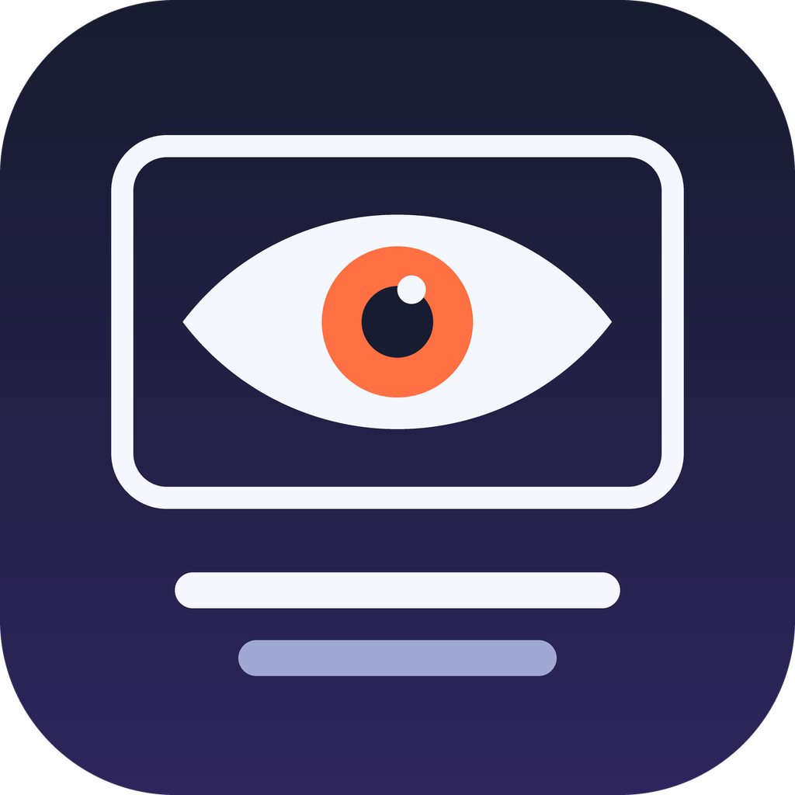

# youtube-watch-skill

**Let your AI agent watch YouTube: transcript + screenshots + search, with zero installs.** · [한국어](README.ko.md)

An Agent Skill for Claude Code (and other Agent Skills hosts). Give your agent a YouTube link and it gets:

- `transcript.txt`: `[mm:ss] line`. Manual subtitles in the spoken language first (or the one you pick with `--lang`), then English, then any other; otherwise auto-captions in the spoken language. Machine-translated and auto-dubbed tracks are skipped.
- Scene-change screenshots (`0012_02m03s.png`), plus at least one every 30 s.
- `index.txt`: each screenshot paired with **what is being said at that moment**, so the agent opens only the images it needs.
- `search`: find videos on YouTube (date, length, views, channel), without leaving the agent.

Everything ships as **one self-contained binary per OS**, with yt-dlp, ffmpeg and deno inside. You don't install Python, pip, Homebrew, winget packages or PATH entries.

## Install

In Claude Code:

```
/plugin marketplace add FRe2Hug/youtube-watch-skill
/plugin install youtube-watch-skill@youtube-watch-skill
```

Then paste a YouTube link and ask, for example: *"Summarize this video and show me the part where they set up the lighting."*

On first use the skill downloads the `ytwatch` binary for your OS (~100 MB) to `~/.claude/bin/`. Supported: Windows x64, macOS Apple Silicon and Linux x64.

**Other agents (Codex, Cursor, Copilot, …)**, not yet verified: the skill folder `skills/youtube-watch/` is self-contained and finds its scripts relative to its own SKILL.md, so it should work with the [Agent Skills CLI](https://github.com/vercel-labs/skills):

```
npx skills add FRe2Hug/youtube-watch-skill
```

Reports from other hosts are welcome as issues.

## What the agent can do with it

| Option | Purpose |
|---|---|
| `--subs-only` | Transcript only. No video download, so it is fast. |
| `--start 2:15 --end 2:45 --max-gap 2` | Zoom into one moment, with a capture at least every 2 s. |
| `--max-frames 40` | Keep at most N captures, spread evenly. Useful for long videos. |
| `--width 768` | Smaller images, fewer tokens. |
| `--dedup [DIFF]` | Drop captures that look almost the same as the last kept one (a still slide or screen). A moving speaker still counts as a change, so it saves little on talking-head videos. |
| `--lang ko` | Prefer subtitles in this language. |
| `--scene 0.2` / `--max-gap 10` | Scene-change sensitivity and the longest gap between captures. |
| `search "query" -n 20 --year` | Search YouTube. `--year` keeps uploads from the last year only. |
| `update` | Replace the binary with the latest release. A new build ships every week with the newest yt-dlp. |
| `selftest` | Offline check that the bundled ffmpeg and deno work. |

**No captions?** Set `GROQ_API_KEY` (free tier) or `OPENAI_API_KEY` and the audio is transcribed with Whisper into the same `transcript.txt` format. Segments that Whisper marks as non-speech, along with its usual filler such as "Thank you." over music, are filtered out. The key is read from the environment only and is never written anywhere. Use `--no-asr` to never send audio.

## Why ytwatch

- **Nothing to install.** The plugin brings one binary with yt-dlp, ffmpeg and deno inside. There is no runtime to set up and nothing to keep updated by hand: `update` fetches a fresh weekly build.
- **Find, then watch.** `search` lists YouTube results with date, length and views, so the agent can pick videos itself.
- **Screenshots that know what is being said.** `index.txt` puts the spoken line next to every screenshot, so the agent reads text first and opens only the images that matter.
- **Clean transcripts.** Machine-translated and auto-dubbed tracks are skipped; without captions, Whisper fills in and its usual filler over music is removed.
- **Token control.** `--max-frames`, `--width`, `--dedup` and `--start/--end` keep long videos affordable.

Not supported: local or offline speech-to-text, local video files and sites other than YouTube.

## Output

```
~/ytwatch/<video id>/
  transcript.txt     # header (title, URL, channel, date, length, views, subtitle source) + [mm:ss] lines
  0001_00m00s.png …  # up to 1280 px wide (--width)
  index.txt          # 0012_02m03s.png  [02:03]  what is said at 02:03
```

The video file is deleted after capture.

## Limits

- YouTube rate-limits heavy use from one IP ("Sign in to confirm you're not a bot", HTTP 429). Fetch videos one at a time. Search plus about 20 transcripts in a burst can trigger it, and it clears in 30–60 minutes.
- Private, members-only and age-restricted videos cannot be fetched.
- Binaries are not code-signed, so Windows SmartScreen may warn when you run the file directly. The plugin downloads it with curl or PowerShell, which does not add a quarantine flag.

## Build

`.github/workflows/build.yml` builds with PyInstaller on Windows, macOS and Linux runners, runs `selftest` and a live YouTube check on each, and publishes a release. It runs on every push to `main` and every Monday. Source: `ytwatch.py`.

Licenses: MIT for this repository. The binaries bundle FFmpeg (GPL) and other components; see [THIRD_PARTY_NOTICES.md](THIRD_PARTY_NOTICES.md).
